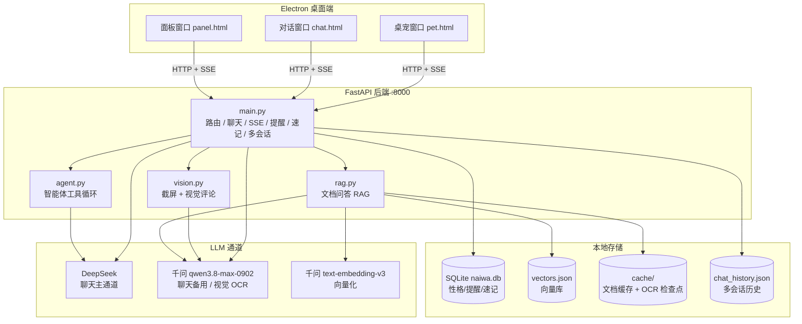

# 架构说明 · AI桌宠助手

基于 LLM 的 AI桌宠助手：FastAPI 后端 + Electron 桌面端，集成流式对话、智能体工具调用、视觉感知、RAG 文档问答与多会话历史。

## 架构总览



## 后端模块

| 模块 | 职责 |
|---|---|
| [main.py](backend/main.py) | FastAPI 入口：聊天（双通道流式）、SSE 主动互动、提醒/速记、多会话历史、工具台端点 / 确认放行、RAG 端点 |
| [agent.py](backend/agent.py) | 统一智能体循环：DeepSeek function-calling，13 个工具（文件读写/移动/删除/bash/内容搜索/提醒/速记/时间等），读类操作全盘免费、写类+命令类动手前确认闸门 |
| [vision.py](backend/vision.py) | mss 截屏 + 千问视觉模型评论；无 Key 时降级为图像分析 |
| [rag.py](backend/rag.py) | 文档问答 RAG：PDF 解析（含扫描页 OCR）、切块、向量化、本地向量检索、文档缓存、断点检查点、按页去重 |
| [gen_sound.py](backend/gen_sound.py) | 互动音效生成 |

## 关键数据流

### RAG 文档问答

```
上传文档 → sha256 算哈希 → 查文档缓存
  ├─ 命中 → 复用缓存切块(含向量),跳过 OCR+嵌入(省模型消耗)
  └─ 未命中 → 解析 PDF
            ├─ 文本层页 → PyMuPDF 直接提取
            └─ 扫描页 → 渲染成图 → 千问视觉 OCR(4 路并行)
                每识别完一页 → 追加写 OCR 检查点(中断可续传)
            → 切块 → 嵌入(text-embedding-v3, 批大小 10)
            → 写缓存 → 删除检查点
            → 写向量库(每块带页码)

提问 → 向量化 query → 余弦相似度检索 top-k → 按页去重(同页只留最相关一块)
     → 拼接上下文 → 流式回答(DeepSeek 主 + 千问备用)
```

### 智能体工具循环

```
用户消息 → /chat → 意图分流
  ├─ 纯聊天 → 流式回复(双通道)
  └─ 任务 → agent 循环: 💭思考 → 🔧调工具 → (写类先弹确认闸门) → ✅结果
     进度经 SSE 实时推到桌面气泡
```

## 关键技术点

### 1. 扫描版 PDF 并行 OCR + 断点续传
- **4 路并行**：`ThreadPoolExecutor` 分页区间并行识别，PyMuPDF 非线程安全，每路 worker 各开独立 doc。比串行约 **4 倍提速**，177 页扫描教材约 **20 分钟**完成。
- **断点检查点**：每识别完一页，把文字追加写到 `cache/{hash}.ocr.jsonl`（一行一页）。中途额度耗尽/断网/关窗后，重新上传同文档自动**续传**，已识别页跳过 OCR，只补识别剩余页，不重复烧额度。
- **OCR 失败重试**：单页 OCR 失败重试 2 次（2s/4s 退避），失败页不写检查点，下次自动重试。

### 2. 检索按页去重
- 每块记录来源页码（解析时每页加 `[[PAGE N]]` 标记，切块后提取）。
- 检索时**同页只保留最相关的一块**，让 top-k 均匀覆盖不同页——避免大文档前几页（目录/概述）的多个块因相似度偏高挤占名额，导致后面页检索不到。
- 问答取 top-10、出题取 top-15，覆盖更多页。

### 3. 文档缓存（省模型消耗）
- 按**内容 sha256** 定身份，缓存 `cache/{hash}.json`（切块+向量）。
- 命中缓存直接复用，**跳过 OCR + 嵌入**，仅给新 doc_id 写向量库。
- 缓存与向量库分离：删除文档只清向量库不动缓存，重新上传同文件仍命中缓存。

### 4. 多会话历史
- `chat_history.json` 存 `{sessions:[...], active_id}`，每会话独立上下文。
- 老扁平格式 `{items:[...]}` **自动迁移**成单会话，升级不丢历史。
- `/history/list`、`/history/add` 默认操作当前会话，桌宠窗口不带 session 参数透明跟随。

### 5. 智能体确认闸门
- 写类/命令类工具动手前 yield `agent_confirm`，挂起等待用户在桌面确认气泡点「放行」。
- 确认卡独立层（不受气泡栈上限/5 秒消失影响），鼠标移上去自动关掉窗口鼠标穿透，按钮可点。

## 性能数据

| 项 | 数值 |
|---|---|
| OCR 并行度 | 4 路，比串行约 4 倍提速 |
| 177 页扫描教材识别 | 约 20 分钟（4 路并行 + 断点续传） |
| 嵌入模型 | text-embedding-v3，批大小 10（API 上限） |
| 向量检索 | 纯 Python 余弦相似度，无 numpy/chromadb 依赖 |
| 检索 top-k | 问答 10 / 出题 15，按页去重 |
| 会话历史上限 | 每会话 300 条 |
| 聊天通道 | DeepSeek 主 + 千问备用，失败自动切换 |

## 测试

核心模块单元测试，标准库 `unittest`，离线可跑（向量化/SSE 用 mock 打桩）：

```bash
.venv/Scripts/python.exe -m unittest tests.test_rag tests.test_history -v
```

- **tests/test_rag.py**（16 例）：文本切块、页码提取、按页去重、检索去重、文档缓存命中/未命中。
- **tests/test_history.py**（12 例）：会话创建、老格式迁移、会话隔离、当前会话切换、历史上限截断。

## 运行

```bash
python launcher.py   # 自动拉后端 + Electron，改代码重跑即生效
```

详见 [README.md](README.md)。
